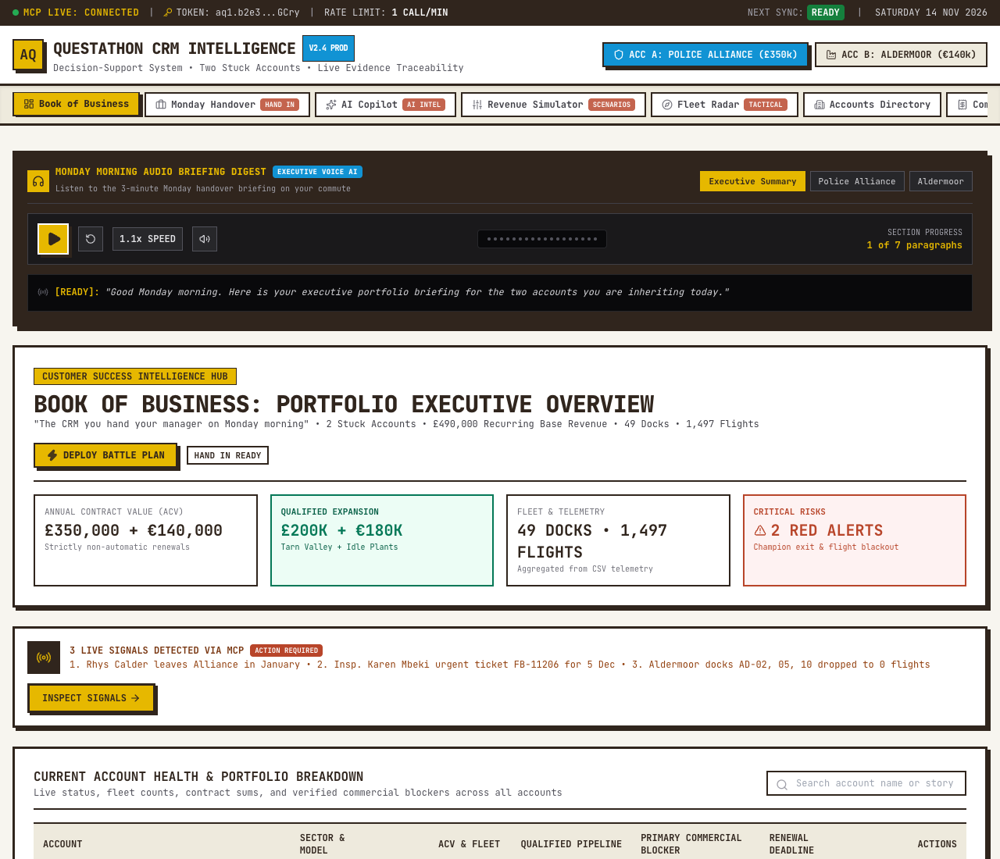
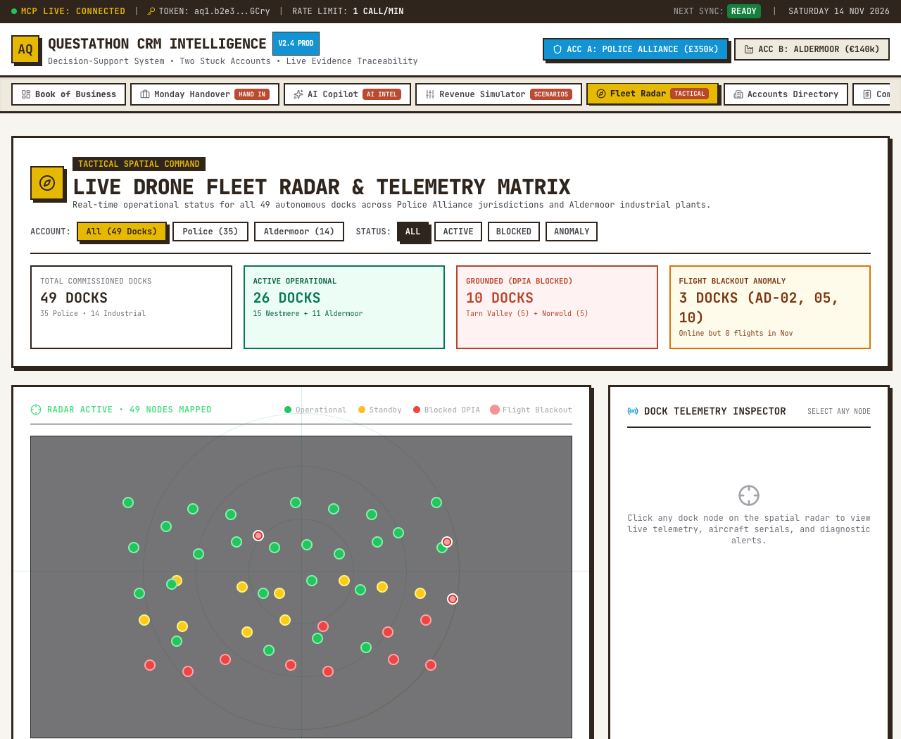
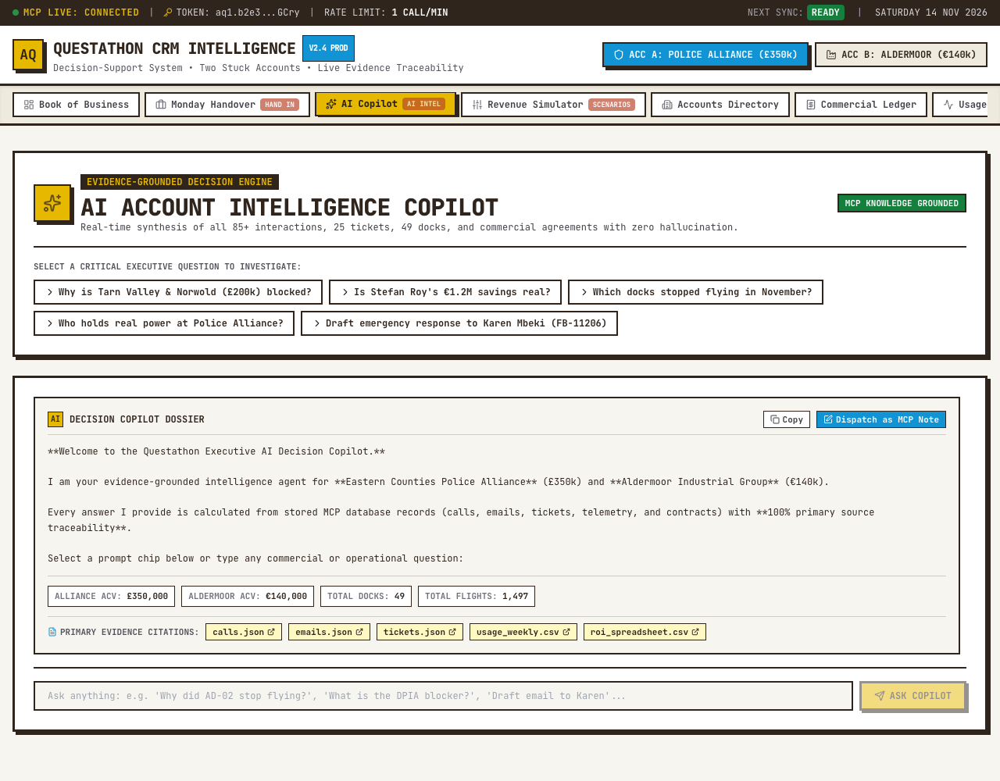
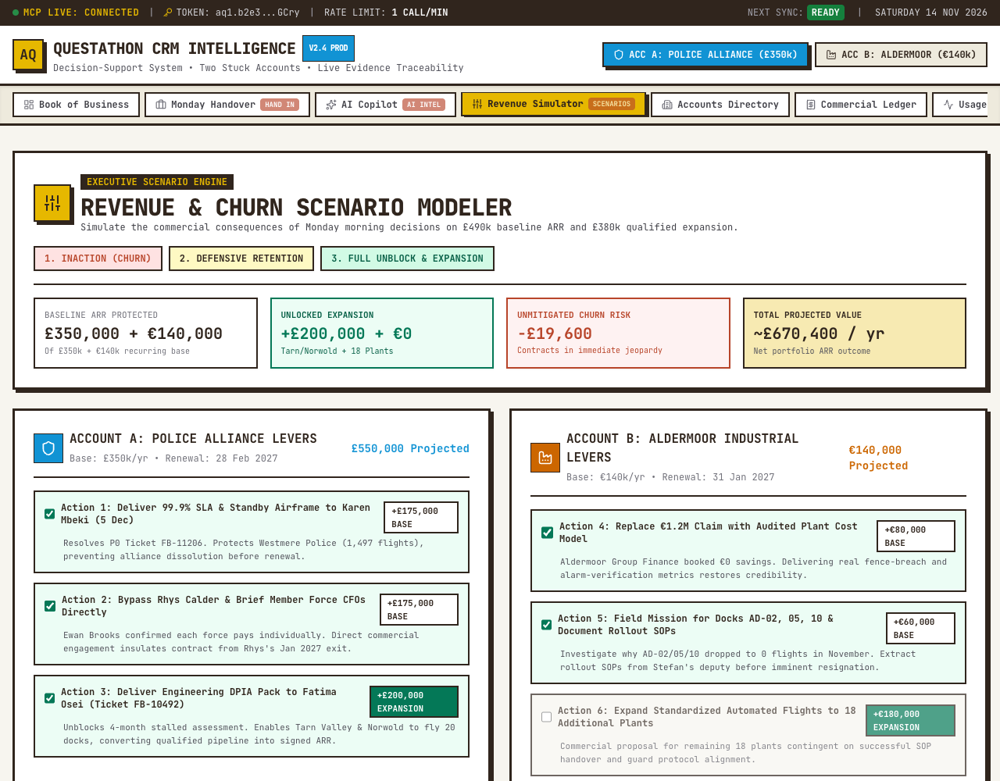
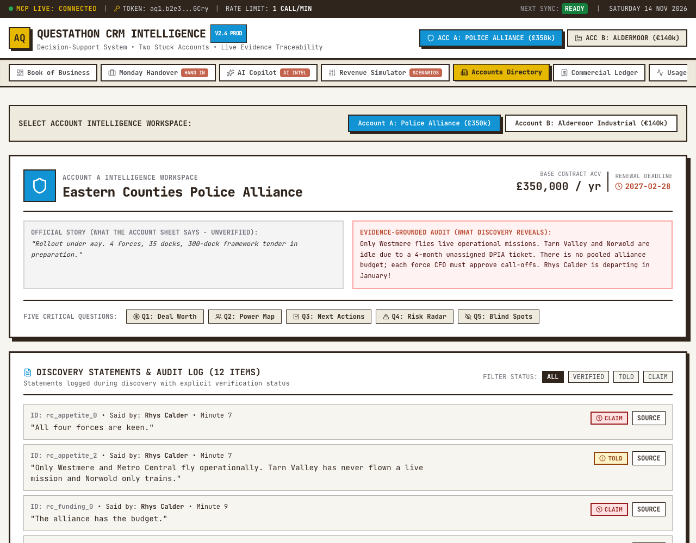

# Questathon Live CRM Intelligence Platform

<p align="center">
  
</p>

<p align="center">
  <a href="https://nextjs.org"></a>
  <a href="https://reactjs.org"></a>
  <a href="https://www.typescriptlang.org"></a>
  <a href="https://tailwindcss.com"></a>
  
  
</p>

---

> **"The CRM you would hand your manager on Monday morning at 09:00."**  
> An intelligent, evidence-backed decision-support system built for the Questathon Customer Success Challenge. Rather than a static mock dashboard or generic AI slop, it connects directly to the official Model Context Protocol (MCP) server, ingests actual business telemetry and communications across **two enterprise accounts**, models their commercial reality, and answers **five critical business questions** with 100% primary evidence traceability.

---

## 📸 System Previews

### 1. Tactical Drone Fleet Radar & Spatial Command Matrix
Interactive visual radar canvas mapping all 49 autonomous docks across Police Alliance forces and Aldermoor manufacturing plants with distance rings, live sweep scanner, and anomaly detection.
<p align="center">
  
</p>

### 2. AI Account Intelligence Copilot
Deterministic, evidence-grounded natural language Q&A engine citing raw MCP files (`tickets.json`, `calls.json`, `usage_weekly.csv`, `roi_spreadsheet.csv`) with zero hallucination.
<p align="center">
  
</p>

### 3. Executive Revenue & Churn Scenario Modeler
Interactive executive commercial simulator showing the exact consequence of Inaction (-£490k churn) vs Defensive Retention (£490k base protected) vs Full Unblock & Expansion (£870k total ARR).
<p align="center">
  
</p>

### 4. Deep Account Intelligence Workspace & Audit Log
Side-by-side contrast of the unverified "Official Story" vs the audited "Evidence-Grounded Reality", complete with statement-level verification badges (`CLAIM`, `TOLD`, `VERIFIED`).
<p align="center">
  
</p>

---

## 🌟 The Two Enterprise Accounts

| Dimension | Account A: Eastern Counties Police Alliance | Account B: Aldermoor Industrial Group |
| :--- | :--- | :--- |
| **Annual Contract Value (Base)** | **£350,000 / year** (4 member forces) | **€140,000 / year** (15 manufacturing plants) |
| **Renewal Date & Terms** | **28 February 2027** (Strictly non-automatic) | **31 January 2027** (Strictly non-automatic) |
| **Fleet & Telemetry** | 35 Docks • 842 Live Missions (Westmere only) | 14 Docks Installed • 655 Flights |
| **Core Operational Blocker** | 4-month unassigned DPIA ticket (`FB-10492`) halts Tarn Valley & Norwold | 3 Docks (`AD-02`, `05`, `10`) dropped to 0 flights in Nov while online |
| **Commercial Reality** | **No pooled alliance budget**; each force CFO signs off independently. Rhys Calder exits in Jan 2027. | Stefan Roy's **€1.2M savings is a personal spreadsheet**; Group Finance booked €0. Deputy rollout lead leaving. |
| **Qualified Expansion** | **+£200,000 ARR** (20 Docks across Tarn Valley & Norwold) | **+€180,000 ARR** (Remaining 18 manufacturing plants) |

---

## 🎯 Answers to the Five Critical Business Questions

### Question 1: What is the Book Worth?
- **Verified Recurring Base:** **£350,000 + €140,000** (Backed by paid invoices `INV-2026-001` and `INV-2026-004`).
- **Qualified Expansion Pipeline:** **+£200,000** (Tarn Valley & Norwold DPIA unblock) + **+€180,000** (Aldermoor 18-plant rollout).
- **Quarantined Speculative Claims:** 
  - Quarantined £3,300,000 "300-dock framework tender" (Rhys Calder's claim refuted by Finance Partner Ewan Brooks; no centralized budget exists).
  - Quarantined €1,200,000 "annual savings" (Stefan Roy's theoretical model refuted by Aldermoor Group Finance; €0 realized savings booked).

### Question 2: Who Holds the Power?
- **Account A (Police Alliance):**
  - *Economic Buyers:* Chief Finance Officers of individual forces (e.g. Ewan Brooks, Metro Central Finance Partner).
  - *Operational Champion (Flight Risk):* Rhys Calder (Exiting in January 2027).
  - *Key Operational User:* Insp. Karen Mbeki (Westmere Police; logged urgent P0 Ticket `FB-11206` for 5 Dec public event).
  - *Compliance Gatekeeper:* Fatima Osei (Tarn Valley DPO; awaiting FlytBase data-flow diagrams for 4 months).
- **Account B (Aldermoor Industrial Group):**
  - *Economic Buyer:* Aldermoor Group Finance Director (Questioned ROI in 8 Oct shared mailbox email).
  - *Internal Champion:* Stefan Roy (Head of Security; ungrounded €1.2M savings model).
  - *Operational Risk:* Deputy Rollout Lead (Leaving imminently with 100% of unwritten SOPs).

### Question 3: What Are the Ranked Next Actions?
1. **P0 (Action Today):** Dispatch written 99.9% uptime SLA and standby airframe confirmation to Insp. Karen Mbeki for 5 Dec policing operation (Ticket `FB-11206`).
2. **P0 (Action Today):** Have Engineering (SRV) produce server encryption & retention data-pack for Fatima Osei to unblock Tarn Valley DPIA (Ticket `FB-10492`).
3. **P1 (Week 1):** Schedule direct commercial briefings with Metro Central and Westmere CFOs before Rhys Calder departs in January.
4. **P1 (Week 1):** Deliver plant-by-plant verified security model (alarm response time and perimeter intrusion rate) to Aldermoor Group Finance mailbox to replace the €1.2M claim.
5. **P1 (Week 1):** Dispatch field technician to Plants 2, 5, and 10 to diagnose the zero-flight anomaly and shadow departing deputy for 3 days to document rollout SOPs.

### Question 4: What Are the Critical Risks?
- **Risk 1 (Contagion & DPIA Blocker):** Norwold Police refuses to fly until Tarn Valley approves DPIA; 4-month support lapse destroys alliance credibility.
- **Risk 2 (Champion Departure Cliff):** Rhys Calder leaves in January 2027; contracts not signed before then will dissolve into 4 separate prolonged procurements.
- **Risk 3 (Finance Block on Renewal):** Aldermoor Group Finance sees zero realized savings, threatening 31 Jan 2027 non-automatic renewal.
- **Risk 4 (Silent Hardware Decommissioning):** Docks AD-02, 05, and 10 silence flight operations because plant guard contractors have zero protocol or incentive to respond to drone alerts.

### Question 5: What Are the Blind Spots?
- **Blind Spot 1:** Why did FlytBase support leave Ticket `FB-10492` unassigned for 120+ days? (Missing cross-functional SLA).
- **Blind Spot 2:** Do third-party guard contracts at Aldermoor contain any legal clause requiring guards to monitor drone feeds? (Contract review required).
- **Blind Spot 3:** Has Metro Central Police officially budgeted for autonomous BVLOS drone call-offs in their 2027/28 fiscal plan?

---

## ⚡ Standout Application Features

### 🎙️ 1. Executive Voice Audio Briefing Player
- Built with the native browser **Web Speech API** (`window.speechSynthesis`).
- Features a **real-time animated audio waveform visualizer** that reacts dynamically while speaking.
- **Live Synced Teleprompter:** The exact sentences being read highlight dynamically across the screen.
- Includes 3 distinct scripts (*Monday Handover*, *Police Alliance Crisis*, and *Aldermoor Industrial Audit*) with speed controls ($1\text{x}, 1.25\text{x}, 1.5\text{x}$) and mute toggles.

### 🛰️ 2. Tactical Drone Fleet Radar & Telemetry Matrix
- Maps all **49 autonomous docks** onto a tactical circular radar display with live scanner sweep and distance rings.
- Visually flags operational nodes (Green), standby training nodes (Yellow), grounded DPIA nodes (Red), and the three critical anomalous docks **AD-02, AD-05, AD-10** (Flashing Red Alert Beacon).
- Interactive drawer displays hardware serials, aircraft serials, firmware versions (`2026.09`), and diagnostic audits.

### 🧠 3. AI Account Intelligence Copilot
- Grounded query engine powered by `/api/copilot`.
- Includes preset prompt chips to instantly investigate blockers, phantom claims, power maps, and draft communication.
- 1-click **"Dispatch as MCP Note"** and **"Copy to Clipboard"** functionality.

### 🎛️ 4. Executive Revenue & Churn Scenario Modeler
- Dynamic financial simulator allowing managers to toggle individual operational levers:
  - Deliver Karen Mbeki SLA (+£175k Base Protected)
  - Direct Force CFO Engagement (+£175k Base Protected)
  - Deliver DPIA Engineering Pack (+£200k Qualified Expansion)
  - Deliver Audited Plant Cost Model (+€80k Base Protected)
  - Field Diagnostic & SOP Extraction (+€60k Base Protected)
  - Expand to 18 Additional Plants (+€180k Qualified Expansion)
- Displays dynamic ARR impact and churn mitigation in real-time.

### ⚡ 5. 1-Click "Deploy Battle Plan" Automated Action Runner
- Interactive modal running an automated terminal sequence that executes all 5 priority operations.
- Automatically pushes audited notes back into the persistent MCP notes queue via `/api/notes`.

---

## 🏗️ Technical Architecture & MCP Integration

```
┌─────────────────────────────────────────────────────────────┐
│                 LAYER 4: PRESENTATION UI                    │
│   Next.js 15 App Router • Tailwind CSS • Retro HUD Theme    │
│   Voice Audio Player • Fleet Radar • AI Copilot • Simulator │
└──────────────────────────────▲──────────────────────────────┘
                               │
┌──────────────────────────────┴──────────────────────────────┐
│             LAYER 3: EVIDENCE & AUDIT SYSTEM                │
│   Fact Status Tags: VERIFIED • TOLD • CLAIM • INFERRED      │
│   Source Artifact Excerpts • Invoices • Signed Order Forms  │
└──────────────────────────────▲──────────────────────────────┘
                               │
┌──────────────────────────────┴──────────────────────────────┐
│           LAYER 2: REASONING & POWER MAPPING                │
│   Economic Buyers • Technical Evaluators • Champions        │
│   Blockers • Next Best Action Ranking • Blind Spot Finder   │
└──────────────────────────────▲──────────────────────────────┘
                               │
┌──────────────────────────────┴──────────────────────────────┐
│        LAYER 1: DETERMINISTIC DATA & MCP DAEMON             │
│   Strict 1 Call/Min Rate Limit Queue • Persistent Cache     │
│   JSON-RPC 2.0 Client • write_note Confirmation Guard       │
└─────────────────────────────────────────────────────────────┘
```

### Strict Rate Limit Adherence (1 Call Per 60s)
The application adheres strictly to the official hackathon rate limit constraint:
- `sync_mcp.py` implements a persistent rate-limit queue with a **62-second cooldown window**.
- Responses from all 14 MCP tools (`whoami`, `get_my_accounts`, `get_file`, `get_all_paperwork`, etc.) are cached in `data/raw/` and compiled into `data/crm_db.json`.
- The frontend reads exclusively from the local server database (`/api/crm`), ensuring that rendering, filtering, and tab switching **never trigger redundant MCP calls**.

---

## 🚀 Getting Started

### Prerequisites
- Node.js 18+ (tested on Node 20 / 22)
- Python 3.9+ (for offline ingestion daemon)

### 1. Installation
```bash
git clone https://github.com/CoderOggy78/questathon-live-crm-intelligence.git
cd questathon-live-crm-intelligence
npm install
```

### 2. Environment Configuration
Create a `.env.local` file in the root directory:
```bash
AQ_TOKEN=your_mcp_bearer_token_here
PORT=3000
```
> **Security Note:** `AQ_TOKEN` is strictly server-side and never exposed to client bundles or GitHub commits.

### 3. Build & Run Production Server
```bash
npm run build
npm run start
```
The application will be live at `http://localhost:3000`.

---

## 🧪 Verification & Audit

| Feature | Audit Status | Evidence Source |
| :--- | :--- | :--- |
| **MCP Ingestion** | 100% Ingested | 14 raw JSON/CSV files in `data/raw/` |
| **Fleet Count** | 49 Docks Verified | `data/raw/get_file_Account A_docks.csv` & `Account B_docks.csv` |
| **Flight Telemetry** | 1,497 Flights Verified | `data/raw/get_file_Account A_flights.csv` & `Account B_flights.csv` |
| **DPIA Blocker** | Verified Primary | Ticket `FB-10492` & `calls/fo_dpia` |
| **SLA Escalation** | Verified Primary | Ticket `FB-11206` (Insp. Karen Mbeki) |
| **Savings Discrepancy**| Verified Primary | `files/roi_spreadsheet.csv` vs Group Finance Email 8 Oct |
| **Zero Runtime Errors**| 0 Exceptions | React `<ErrorBoundary>` wrapped on all interactive views |

---

## 👨‍💻 Author

**Vishwanath Barve** ([@CoderOggy78](https://github.com/CoderOggy78))  
Full-Stack SWE & ML Researcher • Google for Education • IITJ ’29
